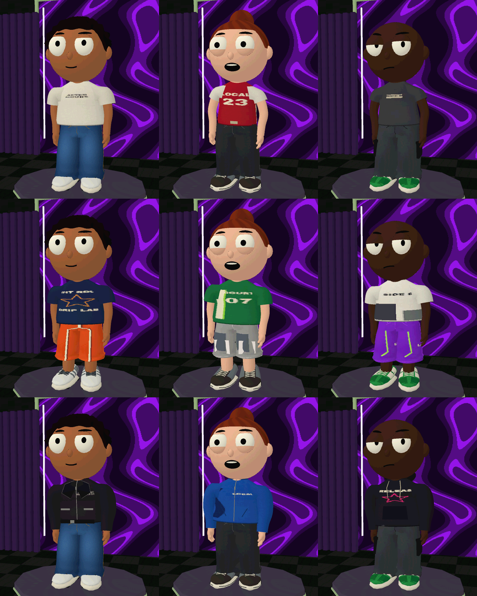
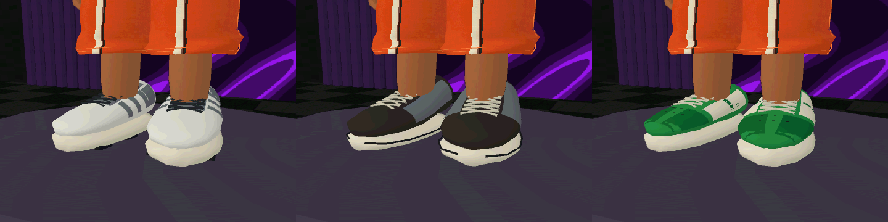

# Streetwear Collection — primeira coleção Blender

17 novas peças, além da jeans baggy Open Court aprovada: nove partes de cima, cinco calças/bermudas e três calçados. Fonte editável: StreetwearCollection.blend. Cada coleção/objeto raiz usa o ID do catálogo, com as peças organizadas em fileiras para inspeção. Texturas originais 512 × 512 estão empacotadas no Blender e em Resources/Garments/Streetwear.

## Modelos
- AFTER HOURS: Last Stop (camiseta ampla com frente discreta e estampa nas costas), Night Route (camiseta gráfica azul), Closing Time (jaqueta preta com lapelas, zíper e cinto), Late Shift (calça reta escura), City Glow (bermuda técnica roxa), Sidewalk (runner claro com apoios e solado segmentado).
- COMMON GROUND: Local Team (jersey sobre camiseta), Court Lines (camiseta esportiva verde), Meeting Point (fleece azul com gola alta e zíper), Home Turf (bermuda de basquete laranja), Daily Steps (court verde/branco com painéis e perfurações). Open Court continua com a baggy anterior.
- SIDE B: Demo Tape (camiseta vintage cinza), Cut & Paste (boxy com recortes), Unreleased (moletom com capuz baixado e bolso canguru), Backstage (cargo carvão), Remix (bermuda patchwork), Garage Session (skate escuro com biqueira larga e solado baixo).

## Integração
Corpos das blusas, golas, lapelas, bolsos, painéis, capuz, calças e calçados são malhas exportadas do Blender. As mangas mantêm a malha de binding reconstruída pela Unity para preservar o encaixe contínuo dos ombros e punhos. No arquivo Blender há mangas de prévia identificadas como BIND_PREVIEW; elas não duplicam a malha no export de runtime.

FBX e UV são convertidos por Tools/Fit Check/Bake Blender streetwear collection para JSON de runtime. As aberturas dos ombros seguem o contorno do binding original; editar esses vértices exige atualizar o binding correspondente. A orientação horizontal de UV de blusas e calças é tratada separadamente na importação. IDs, drops, critérios, saves e desbloqueios permanecem os existentes.

As referências do usuário orientaram proporções, sobreposição, grafismos e materiais. Não foram coladas fotos de pessoas ou anúncios nas roupas. Fontes, padrões e estampas destas peças são originais do projeto.

## Prévia nativa na Unity

## Acabamento e moradores

A revisão de 04/11/2026 mantém a modelagem e a resolução, melhora o tecido/estampas/mangas e separa o vestuário civil das peças da loja. Receitas em `paint_uv_finish.py` e `paint_basic_fabrics.py`; detalhes e medições em [WardrobeFinish](../../Performance/WardrobeFinish.md).
